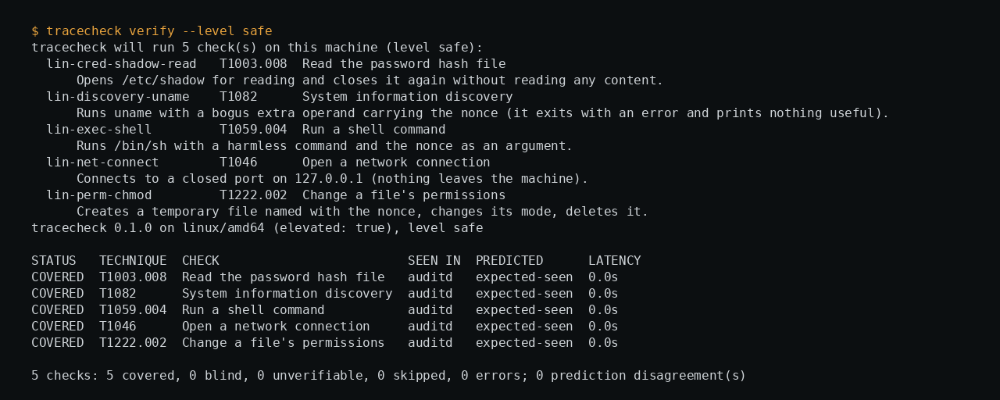

# tracecheck

Does this host really log what you think it logs?

`tracecheck` performs harmless, reversible versions of common attacker
techniques — running a shell command, reading `/etc/shadow`, making a
loopback connection, changing a file's permissions, creating (then deleting)
a cron job or an account — and checks whether the host's *own* logging
(Linux kernel audit / journald / syslog, Windows Security + Sysmon +
PowerShell event logs) actually recorded each one. It also builds a
prediction from the host's configuration (is there an audit rule for this
syscall? is this audit subcategory set to Success?) and tells you when the
prediction and the observation disagree — which is usually more interesting
than either one on its own.

A second mode, `watch`, drops a handful of decoy files (a fake
`~/.aws/credentials`, an `id_rsa`, a `kubeconfig`, a `.env`) and alerts —
optionally denying, suspending, or killing the process — the moment
something opens one.

A third mode, `monitor`, re-runs the safe checks on a schedule and raises an
alert the moment a previously-covered technique goes dark (a rule removed,
`auditd` stopped, a GPO reset) — and again when it comes back. This is the
part that turns a one-time audit into something worth leaving running.

## Why this exists

Most "is my logging any good?" tooling (atomic-red-team runners, CALDERA,
Sigma rule testers) assumes you already have a SIEM to check the results
in. tracecheck doesn't: it reads the host's actual configuration and its
actual log files directly, so it works on a bare Linux box with `auditd`
and nothing else, or a Windows machine with no Sysmon installed — in both
cases it tells you plainly what you do and don't have, rather than failing
to run.

It is **not** claiming to be the only tool that does this, and it is
**not** a safety guarantee. It checks a small, fixed set of techniques. A
host that is fully "covered" by tracecheck's checks can still miss a real
attack that doesn't look like any of them. Treat a clean report as "basic
telemetry hygiene confirmed," not as "we will detect everything."

## What it is not

- Not an exploit framework. Every canary is a benign, reversible action —
  there is no payload, no privilege escalation, no lateral movement.
- Not a vulnerability scanner.
- Not a replacement for Sigma/detection-rule testing against a real SIEM —
  it answers a narrower, earlier question: does *any* telemetry even reach
  a log a human or a SIEM could read?
- Not a guarantee of detection coverage. See above.

## Install

Requires Go 1.22+.

```sh
git clone https://github.com/0xM44k/tracecheck
cd tracecheck
go build -o tracecheck ./cmd/tracecheck
```

Cross-compiles cleanly for Windows (`GOOS=windows go build ...`); Linux is
where it has been run live and verified against a real kernel. Windows
support is built, vetted, and exercised on every push by the CI workflow's
`windows-latest` job (see `.github/workflows/ci.yml`), which enables the
real audit policy and verifies against the real Security/Sysmon event logs
on that runner.

## Quick start

```sh
sudo ./tracecheck inspect              # what does this host's config say it should log?
sudo ./tracecheck verify --level safe  # run the harmless checks, compare to what actually got logged
sudo ./tracecheck rules --from report.json   # (after --format json --out report.json) auditd rules / Windows commands that close the gaps found above
sudo ./tracecheck watch --dir /tmp/decoys --contain alert --duration 10m
sudo ./tracecheck monitor --state /var/lib/tracecheck/state.json --interval 5m
```

`verify` never applies configuration changes by itself; `rules` only
*prints* rules for you to review and load yourself (`auditctl -R`,
`augenrules --load`, or the printed Windows commands). Nothing here
silently changes your audit policy.

### `--level full`

A second tier of checks (`--level full --yes`) actually creates and then
removes a cron entry, a systemd unit, a profile.d script, and a local user
account, to check persistence- and account-creation telemetry. These are
reversible and tracecheck removes everything itself, logging a cleanup
error loudly if it can't (with the nonce needed to remove it by hand). Run
this only on a machine you're authorized to test on, ideally a VM.

## Consent and safety

- Every action is harmless and reversible; nothing is left behind.
- `--level full` requires an explicit `--yes`.
- `watch`'s containment modes (`deny`/`suspend`/`kill`) only ever act on a
  process that opened a decoy file tracecheck itself created, in a
  directory you pointed it at. tracecheck's own process, its ancestors, and
  PID 1 are always excluded. Nothing resembling "hack back" against a
  remote attacker is implemented or planned: containment is local-only,
  against a local process, on a host you run tracecheck on.
- Run it on hosts you own or are explicitly authorized to test.

## Evidence

A real run on this machine, clean slate to fully covered (see `docs/verify-evidence.png` for the screenshot):



## How it's verified

This isn't "should work" — every mode has been run against a real kernel
(see `.github/workflows/ci.yml` for the exact commands, run on every push):

- `verify --level safe`: run from a clean slate (no audit rules loaded) —
  came back correctly as mostly blind, with predictions agreeing. After
  loading the rules tracecheck itself generated, a second run came back
  fully covered with zero prediction disagreements.
- `watch`: real `cat`/`bash`/`python` processes touching decoys produced
  alerts carrying the real pid, exe, cmdline and ancestor chain, in all
  four containment modes (`alert`, `deny` → `EPERM`, `suspend` → the
  process actually stops, `kill` → `SIGKILL`), plus confirmed that an
  allow-listed command (`--allow-comm`) passes through untouched.
- `monitor`: a rule removed mid-run produced a live `REGRESSION` alert;
  restoring it produced a live `RECOVERY` alert, both against the real
  audit log.
- Unit tests cover the matching logic (hex-encoded audit values, PID
  correlation, time-window filtering), the host-configuration parsers, the
  verification state machine (with fake sinks), the rules generator (rule
  de-duplication), the monitor's regression/recovery comparison, and report
  rendering — `go test ./...`.

## What's covered today, and what's honestly not yet

**Covered and live-verified:** Linux kernel audit (`auditd`), journald,
syslog files; Windows event log channels (Security, Sysmon, PowerShell,
TaskScheduler, System) via `wevtutil`, audit policy via `auditpol`, and
registry checks via `reg query`; the decoy/deception layer on Linux via
`fanotify` permission events, and on Windows via SACL + polling event 4663.

**Not yet implemented, listed honestly rather than silently skipped:**

- **macOS.** No canaries, no sink, no telemetry model. Would need
  `eslogger`/EndpointSecurity for the kernel side and the unified log
  (`log show`) as the sink — a real, separate piece of work, not a trivial
  port.
- **eBPF/ETW as a direct telemetry source.** tracecheck currently checks
  whether auditd/Sysmon/Security-log *already* turned a syscall into a
  readable log line. It does not attach its own eBPF probe or ETW
  consumer to check "is the kernel event itself even firing" independent
  of whatever's consuming it. That's a meaningfully deeper (and far more
  invasive) check and was deliberately left out of a tool whose promise is
  "harmless and reversible."
- **SIEM forwarding verification.** tracecheck checks the host's local log,
  not whether that log actually reaches your Splunk/Elastic/Wazuh. A
  forwarder that's silently stopped would show as "covered" here.
- **Deeper Sysmon config analysis.** Today's Windows prediction model
  checks `auditpol` subcategories and a few registry keys; it does not
  parse an installed Sysmon XML config to predict which specific event
  types it will emit.
- **Live Windows deception beyond polling.** The Windows decoy watcher uses
  SACL plus polling event ID 4663 rather than a true kernel-level
  intercept, so containment latency is bound by the poll interval (this is
  disclosed in the code and CLI help, not hidden).

If you build any of these, a PR implementing one of them with the same
bar — real telemetry, tests, and a live-verified CI job — is exactly the
kind of contribution this project wants.

## Commands

```
tracecheck list     [--level safe|full]
tracecheck inspect  [--format text|json]
tracecheck verify   [--level safe|full] [--yes] [--dry-run] [--only ID,ID] [--timeout 12s]
                    [--format text|json|html] [--out FILE] [--fail-on-blind] [--hostname]
tracecheck rules    [--from report.json | --missing-only] [--only ID,ID]
tracecheck watch    [--dir DIR] [--contain alert|deny|suspend|kill] [--allow-comm a,b]
                    [--log FILE] [--syslog] [--duration 10m] [--keep]
tracecheck monitor  [--state FILE] [--interval 30m] [--once] [--alert-log FILE] [--only ID,ID]
tracecheck version
```

Run `tracecheck <command> -h` for the full flag list.

## License

MIT — see [LICENSE](LICENSE).
